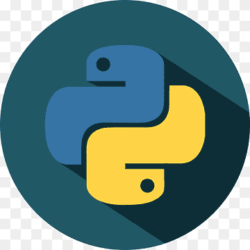
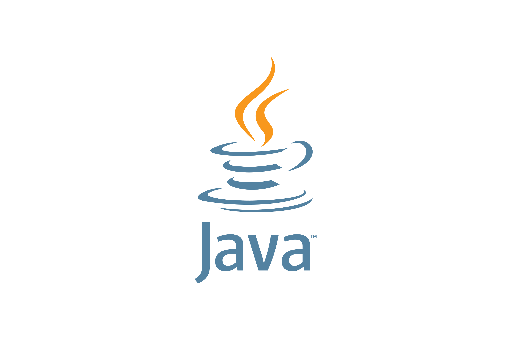
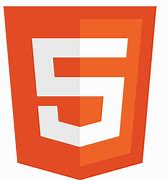
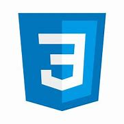

### Hi there 👋

<!--
**Fatimatulzahra/Fatimatulzahra** is a ✨ _special_ ✨ repository because its `README.md` (this file) appears on your GitHub profile.

Here are some ideas to get you started:

- 🔭 I’m currently working on ...
- 🌱 I’m currently learning ...
- 👯 I’m looking to collaborate on ...
- 🤔 I’m looking for help with ...
- 💬 Ask me about ...
- 📫 How to reach me: ...
- 😄 Pronouns: ...
- ⚡ Fun fact: ...
-->

- ✨ Welcome to Fatimah's Profile
- 🔭 I'm currently working on a personal project to improve my hardware engineering skills.
- 🌱 I'm currently learning C
- 📫 How to reach me: Email: zahranike04@gmail.com
- 😄 Pronouns: She/her
- ⚡ Fun fact: Uhh, I love watching animeeeeee.

<b>My Core Languages</b>
  
<code></code>
<code></code>

<b>Connect with me</b>
  

<b>Frameworks I use</b>
  
<code></code>
<code></code>
